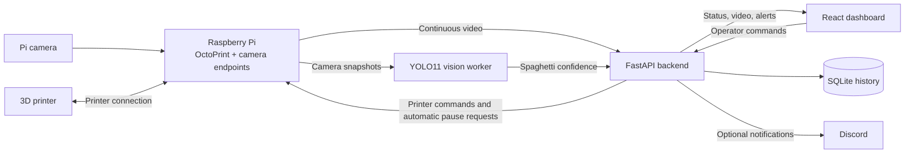

# LayerLock

**Camera-based failure detection and control for 3D printing.**

Built for **SBUHacks 2026 — Steel and Steam**, LayerLock brings live video, computer vision, and printer controls into one dashboard. A Raspberry Pi and Pi camera watch the print while OctoPrint connects the printer to the application. When monitoring is armed and sustained spaghetti detection crosses the intervention threshold, LayerLock requests a pause, alerts the operator, and records the incident for review.

Failed prints consume filament, machine time, and attention. LayerLock helps operators spot problems earlier and decide whether to recover a print or cancel it, using an existing printer and a camera-based monitoring setup.

## What LayerLock does

- **Live View:** Continuous camera video with automatic reconnection and a manual refresh button. Video streams independently of failure detection.
- **Camera-based detection:** A pretrained YOLO11 model analyzes snapshots for spaghetti failures. Vision detection can be enabled or disabled from the dashboard.
- **Automatic pauses:** A separate arming control enables automatic intervention during a print. The dashboard shows whether monitoring is armed and whether vision readings are fresh.
- **Printer controls:** Connect to the printer, start a selected file, pause, resume, or cancel a job through OctoPrint. Head and bed homing controls are available when the printer is operational and idle.
- **G-code management:** Upload, search, select, and remove files stored on OctoPrint. File selection is locked during an active print, and the current print file is protected from deletion.
- **Real print telemetry:** Printer state, completion percentage, elapsed time, and estimated time remaining come from OctoPrint.
- **Temperature history:** Actual and target tool and bed temperatures appear together on a rolling graph.
- **Events and issue history:** Persistent records show printer actions and pause/cancel incidents, including the file, full date and time, reason, and outcome. Observed actions initiated outside the dashboard are labeled external/unknown.
- **Operator recovery and alerts:** Detected issues appear in a review panel with resume and cancel controls. An optional Discord webhook sends failure notifications.

The monitoring hardware consists of a **Raspberry Pi and camera**, alongside the printer and its connection to OctoPrint. Detection uses camera images; no additional physical sensors, Arduino, or servo gauges are required. Temperature readings come from the printer's existing telemetry.

## How it works



The Raspberry Pi provides OctoPrint connectivity and camera access. The backend, vision worker, and dashboard run on the application host, which can be separate from the Pi. In the current setup, the application runs on a computer connected to the Pi over the local network.

The vision worker samples snapshots approximately every three seconds, subject to inference and network time. The backend uses the highest spaghetti detection confidence as its failure signal. While monitoring is armed and the printer is printing, confidence of **70% or higher sustained for at least five seconds across fresh readings** triggers a pause request.

Each intervention is saved with print context and the pause request's outcome. The dashboard then presents the issue for the operator to inspect and resolve. Accepted commands are distinguished from the printer's reported state, which is confirmed through subsequent OctoPrint telemetry.

Live readings older than ten seconds cause monitoring to disarm. Disabling vision also disarms automatic pauses, while Live View remains available. Monitoring runs independently of the browser as long as the backend and vision worker remain active.

## Using the dashboard

1. **Connect the printer** from Machine Status and confirm that it is operational.
2. **Enable vision** and wait for fresh detection readings.
3. **Upload and select G-code**, then press Print and complete the start review.
4. **Check Automatic pauses.** Starting a print through LayerLock with fresh vision readings arms monitoring automatically. For a print started outside LayerLock, use Arm automatic pauses once it is running.
5. **Review detected issues.** Inspect the print, resolve the cause, and choose Resume or Cancel. The incident remains in Print issue history after recovery.

Vision detection and automatic intervention have separate controls: detection can continue while automatic pauses are disarmed. Resume requires a paused printer and a sufficiently heated nozzle; recovery from a detected issue also requires fresh vision readings.

## Technology

| Component | Implementation |
|---|---|
| Camera and printer connection | Raspberry Pi, Pi camera, OctoPrint |
| Computer vision | Python, Ultralytics YOLO11, OpenCV, PyTorch |
| Backend and printer integration | FastAPI, HTTPX, OctoPrint REST API |
| Dashboard | React, Vite, Recharts, Lucide icons |
| Persistent records | SQLite |
| Optional notifications | Discord webhook |

The prototype has been integrated with an **Ultimaker 2+ through OctoPrint**. The dashboard's brass and industrial styling reflects the hackathon's Steel and Steam theme.

## Run LayerLock

### Requirements

- A Raspberry Pi running OctoPrint, connected to the printer.
- A configured camera with reachable snapshot and MJPEG stream URLs.
- An application host with Python 3.12, Node.js, and npm.
- Network access from the application host to the Pi.

The commands below use Windows PowerShell, matching the current application setup.

### Install dependencies and model weights

From the repository root:

```powershell
python -m venv .venv
.\.venv\Scripts\python.exe -m pip install -r requirements.txt -r vision/requirements.txt
.\.venv\Scripts\python.exe vision/src/download_model.py
npm.cmd --prefix frontend ci
Copy-Item .env.example .env
```

### Configure the connection

Set the following values in the root `.env` file, replacing the placeholders with the Pi address and an OctoPrint API key:

```dotenv
PRINTER_TYPE=octoprint
OCTOPRINT_URL=http://<pi-address>
OCTOPRINT_API_KEY=<your-api-key>
SNAPSHOT_URL=http://<pi-address>/webcam/?action=snapshot
STREAM_URL=http://<pi-address>/webcam/?action=stream
DISCORD_WEBHOOK_URL=
```

`DISCORD_WEBHOOK_URL` is optional. Credentials stay on the backend. The example configuration defaults to a mock printer; `PRINTER_TYPE=octoprint` enables the real printer connection.

### Start the application

```powershell
.\start-dev.ps1
```

Open the dashboard URL printed in the terminal, normally `http://localhost:5173`. Keep the terminal open while using LayerLock. Starting with `npm.cmd run dev` from `frontend` also starts the backend when needed. Startup checks reuse an existing healthy LayerLock backend and wait for the API to be ready before opening the dashboard.

The dashboard starts with automatic pauses disarmed. Enable vision and follow the operating steps above. After restarting the backend, check vision and arming status again.

## Project structure

| Path | Purpose |
|---|---|
| `backend/` | FastAPI application, monitoring, printer integration, and persistence |
| `tests/` | Backend and integration regression tests |
| `tools/` | Explicit printer configuration utilities |
| `docs/` | Setup, operation, and validation guides |
| `frontend/` | Dashboard, live camera view, printer controls, charts, and history |
| `backend/main.py` | API routes, monitoring coordination, and recovery workflow |
| `backend/printer.py` | OctoPrint telemetry, file management, and printer commands |
| `backend/risk_engine.py` | Sustained-confidence threshold and monitoring state |
| `backend/vision_service.py` | Dashboard-controlled vision worker lifecycle |
| `vision/src/` | Camera capture, YOLO inference, and evaluation tools |
| `backend/telemetry.py` | Shared printer polling and temperature history |
| `backend/incident_db.py` | Persistent printer events, actions, and detected incidents |
| `backend/notification.py` | Discord notification integration |
| `pi-module/` | Printer integration library, command-line tools, and G-code hooks |

## Scope and operation

The current detector focuses on visible **spaghetti failures**. Model confidence is a detection signal, not a calibrated probability that a print has failed. Camera placement, lighting, occlusion, and print geometry affect results; the project does not claim detection of every failure type.

LayerLock currently operates on a trusted local network. Public internet access and application authentication are not configured. The application host must stay awake and connected for monitoring and automatic pauses to remain available.

Printer motion during pause, resume, cancellation, and completion follows the installed OctoPrint G-code hooks and firmware configuration. Automatic parking is not enabled in the current setup. Homing requires working endstops and a clear machine. LayerLock complements operator supervision and the printer's existing protections.

## Documentation and model attribution

- [Dashboard and OctoPrint integration](docs/INTEGRATION.md)
- [Vision inference and camera connection](vision/docs/PI_INFERENCE.md)
- [Testing and validation](docs/TESTING.md)
- [Pi integration tools](pi-module/README.md)
- [Dataset evaluation](vision/docs/DATASET_EVALUATION.md)
- [Video evaluation](vision/docs/TEST_VIDEOS.md)
- [Pretrained 3D print failure detection model](https://huggingface.co/ApatheticWithoutTheA/3D-Print-Failure-Detector), used through Ultralytics YOLO.
